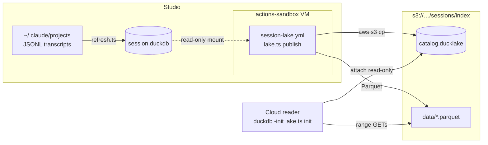
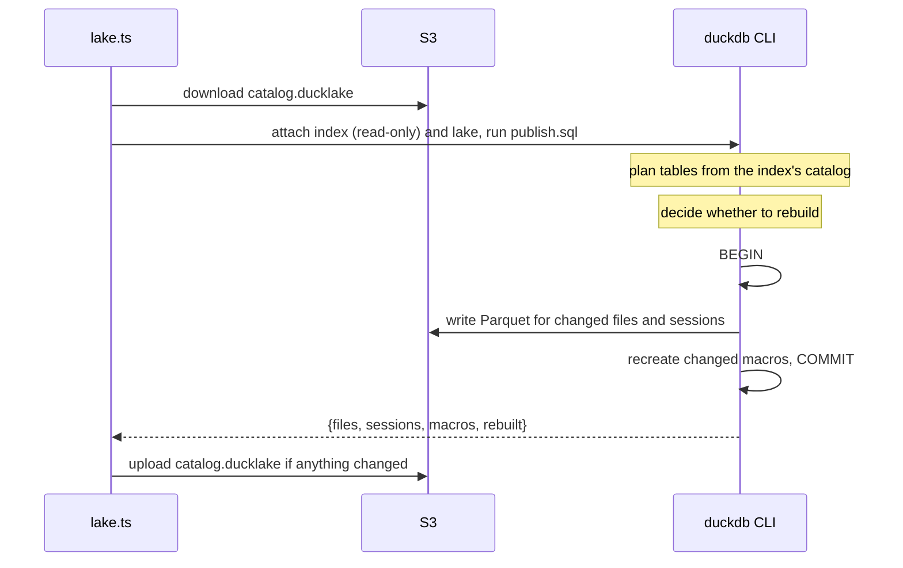
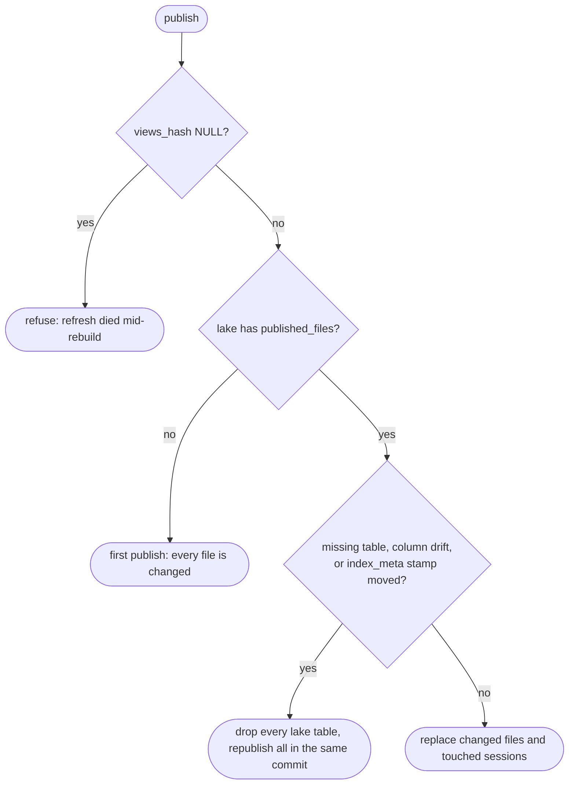

# Session Lake

The session index is a DuckDB file on the Mac. Agents in cloud sessions can't open it, and downloading it costs gigabytes per reader. The lake is a copy of the index on S3 in [DuckLake](https://ducklake.select) format: a small DuckDB catalog file plus immutable Parquet files. A reader attaches the catalog and fetches only the row groups its query touches, so a query bounded by a date window reads megabytes. The measurements behind that are in [#1881](https://github.com/bendrucker/claude/pull/1881#evidence).

The publish only reads the local index, and the lake can be rebuilt from it at any time.

## Topology



A nightly GitHub Actions job runs on the Studio's ephemeral runner, a Linux VM that mounts the index directory read-only. Sundays also run DuckLake's `CHECKPOINT`, which merges small files and expires snapshots older than seven days. That window must outlast the longest reader, since a reader may still be fetching files that an expired snapshot referenced.

Only `local` sessions are published by default. Another host is published only when it is named with `--host` and was imported with `--egress`.

## Division of Work

`resources/lake/publish.sql` does the publish and runs in the DuckDB CLI. `scripts/lake.ts` covers only what SQL can't:

- refusing hosts without an egress policy
- moving the catalog file to and from S3, since DuckDB can't write a database file there
- attaching the index and lake, because the CLI's `ATTACH` only accepts literals
- writing the reader's init file

The CLI's version must match `@duckdb/node-api`'s, which wrote the index. A newer CLI writes a catalog that older readers can't open.

## Publish



The writer downloads the remote catalog before every run, so a stale local copy can never overwrite newer snapshots. Parquet files are immutable and the catalog uploads only after the commit. A reader therefore sees either the previous snapshot or the new one. Only one writer may run at a time: two concurrent publishes would each upload a catalog missing the other's snapshot. The workflow's concurrency group enforces that.

### Table Plan

The table list comes from the index's own catalog, so the lake mirrors whatever plugin version built the index. Each table or view is published by one of three rules:

| Kind | Tables | Replaced |
| --- | --- | --- |
| File | `raw`, `file_fields` | Per changed file |
| Session | Every table and view with a `session_id` | Per touched session |
| Whole | The rest: `meta`, `index_meta`, `fields`, `field_triage`, `view_paths` | Whole, on any change, first publish or rebuild |

A changed file is one whose `(mtime, size)` in `indexed_files` differs from the lake's `published_files`, including files added or removed. A touched session is any session with rows in a changed file, before or after the change.

Views are published as tables. A view that parses `data` at query time would cost a reader the JSON across its whole window, and the JSON columns are almost all of the lake's bytes. Materialized, a query reads only the columns it selects. `classifier_verdicts` reads local telemetry and is not published.

### Rebuilds



A change to `views.sql` or the pinned projection rewrites rows of files whose stats never changed, so the diff can't find them. The `index_meta` stamp (version, views hash, import hash) catches those changes, and the shape comparison catches a table that changed without one.

### Macros

Macros live in the lake's catalog, so a reader's init only attaches it. The publish recreates each macro whose definition in the index differs from what it last published, as recorded in `published_macros`. It can't compare against the lake's own copy, because DuckDB doesn't print a macro back identically. The table macros that read the refresh's scope tables stay local.

DuckDB 2.0 prints a stored macro's lambdas in the deprecated arrow form. The writer and readers both set `lambda_syntax = 'ENABLE_SINGLE_ARROW'` to accept them.

### Layout

- Rows sort by `type`, then `timestamp`, in 8,192-row row groups. A filter on a rare record type skips the row groups of every other type, and a window filter still prunes within each type's run.
- A first publish inserts sessions in batches of about 512 MB of raw text, ordered by session start, so each insert's sort fits in memory.
- Session filters are uncorrelated `IN` lists. A correlated `EXISTS` plans as a delim join that buffers every row of the outer table, JSON included.

## Readers

```sh
duckdb -init "$(bun plugins/observability/skills/session/scripts/lake.ts init)" -c "<sql>"
```

The init file carries `limits.sql`, the S3 setup in `lake/s3.sql`, and the read-only attach. Its `search_path` resolves unqualified names to the lake, so table, view and macro names match the local index. The file is written into a directory only the current user can access, named by a hash of its contents.

Every byte read is S3 egress. A query bounded by a date window that selects only the columns it needs reads megabytes. A query that parses `data` across all history can read hundreds of megabytes. Named queries that read local telemetry or files on the Mac (`index-health`, `classifier`, `sandbox-bypass-scaffold`, `mods`) run only against a local index.
