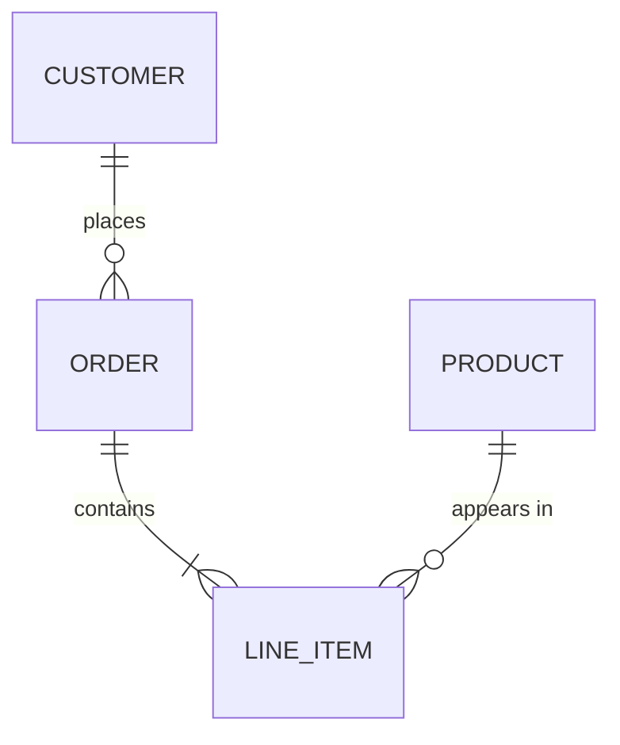
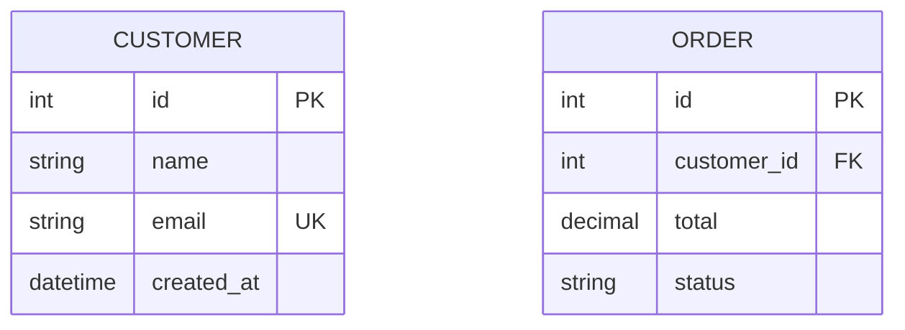

# Entity-Relationship Diagram Reference

## Basic Syntax



Quote a relationship label that contains spaces.

## Entities

Define entities with attributes:



Attribute markers are `PK` (primary key), `FK` (foreign key), and `UK` (unique key).

## Relationship Cardinality

```
ENTITY1 <left-cardinality>--<right-cardinality> ENTITY2 : "label"
```

Left side | Right side | Meaning
----------|------------|--------
`\|o` | `o\|` | Zero or one
`\|\|` | `\|\|` | Exactly one
`}o` | `o{` | Zero or more
`}\|` | `\|{` | One or more
