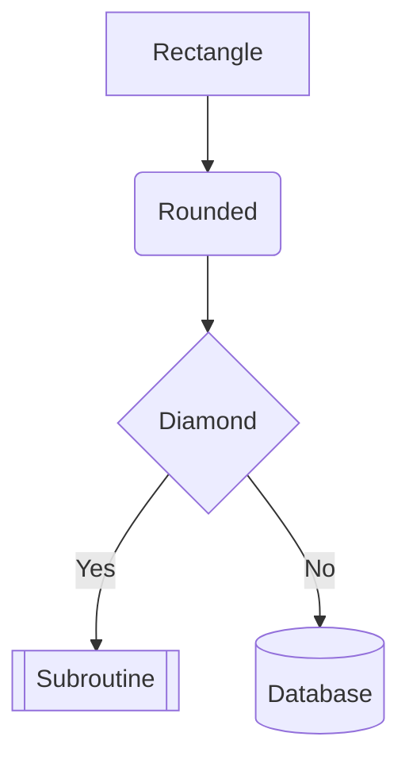
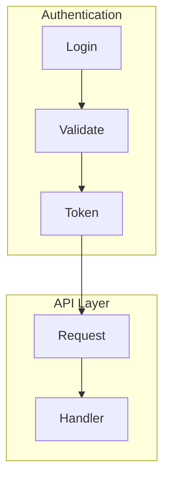
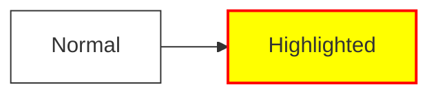

# Flowchart Reference

## Basic Syntax

## Direction

| Directive | Direction |
|-----------|-----------|
| `TB` / `TD` | Top to bottom |
| `BT` | Bottom to top |
| `LR` | Left to right |
| `RL` | Right to left |

Use `LR` for timelines and processes. Use `TB` for hierarchies and for diagrams too wide for `LR`.

## Node Shapes

| Syntax | Shape | Use For |
|--------|-------|---------|
| `[text]` | Rectangle | Actions, processes |
| `(text)` | Rounded | Start/end points |
| `{text}` | Diamond | Decisions |
| `[[text]]` | Subroutine | Function calls |
| `[(text)]` | Cylinder | Databases |
| `((text))` | Circle | Events, triggers |
| `>text]` | Flag | Async signals |
| `{{text}}` | Hexagon | Preparation steps |

## Edge Types

| Syntax | Style |
|--------|-------|
| `-->` | Arrow |
| `---` | Line (no arrow) |
| `-.->`| Dotted arrow |
| `==>` | Thick arrow |
| `--text-->` | Arrow with label |
| `-->\|text\|` | Arrow with label (alt) |

## Subgraphs

Subgraphs inherit the parent direction. Use them to group by component, team, or phase.

## Styling

