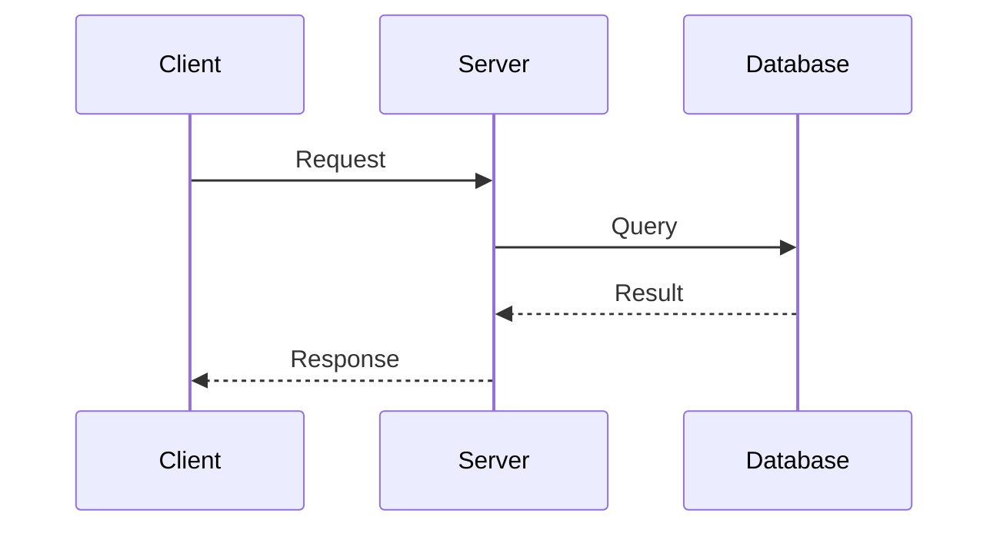
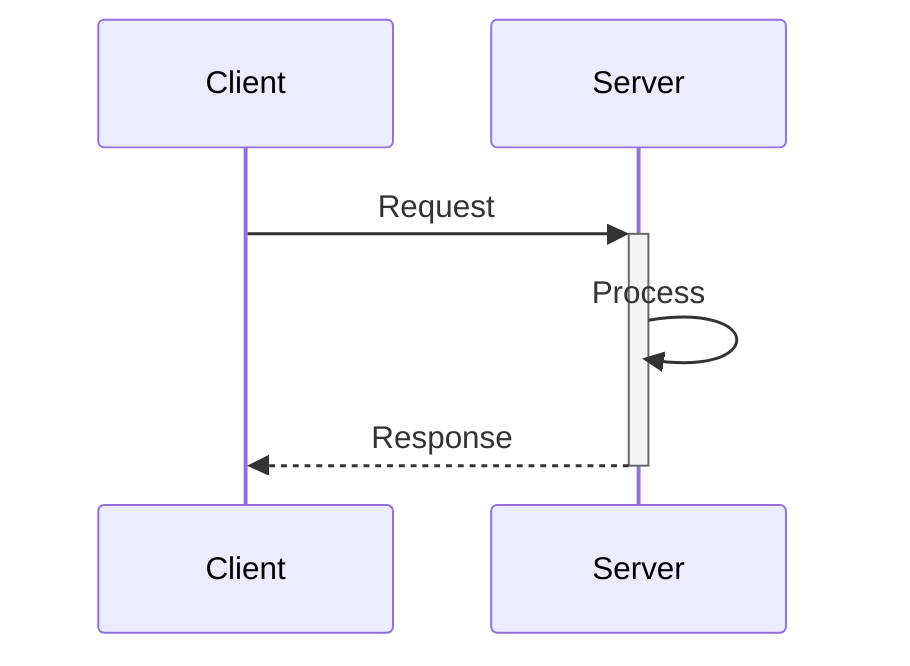
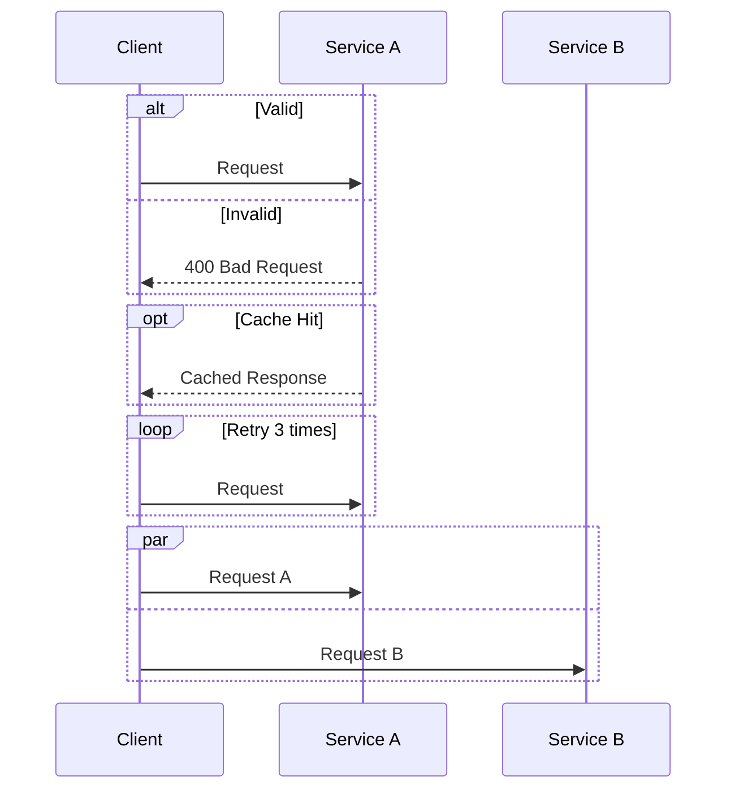
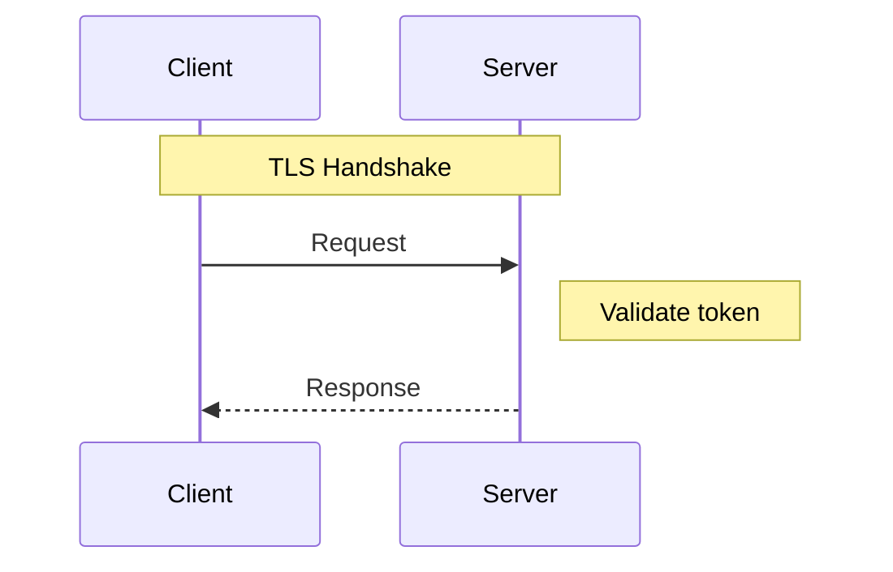

# Sequence Diagram Reference

## Participants

Declare participants in data-flow order to set their left-to-right position. Aliases shorten labels.

## Message Types

| Syntax | Meaning |
|--------|---------|
| `->>` | Synchronous request |
| `-->>` | Async/return response |
| `--)` | Async message (no wait) |
| `-x` | Lost message |
| `--x` | Lost async message |

## Activations

`+` activates and `-` deactivates. Activations can nest.

## Control Flow

## Notes

