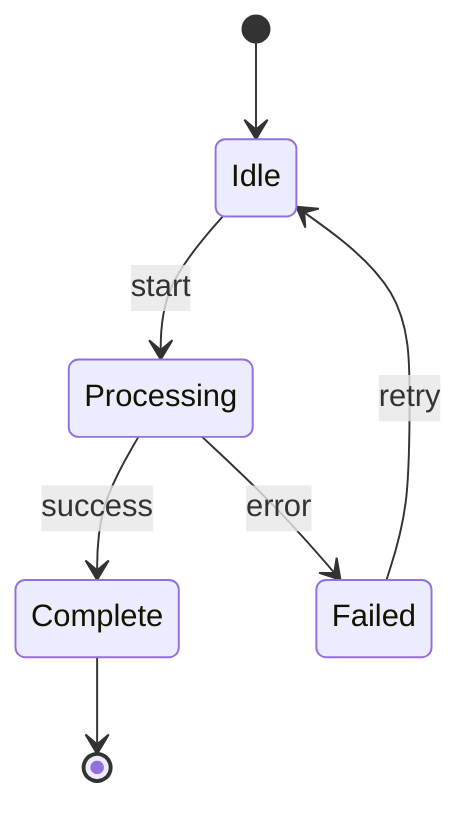
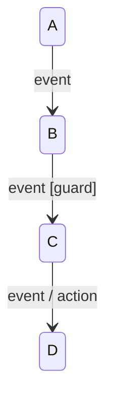
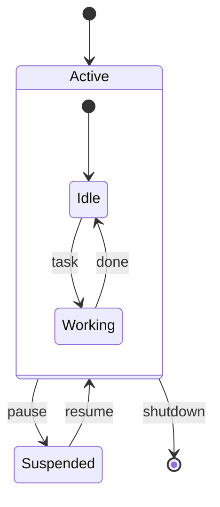
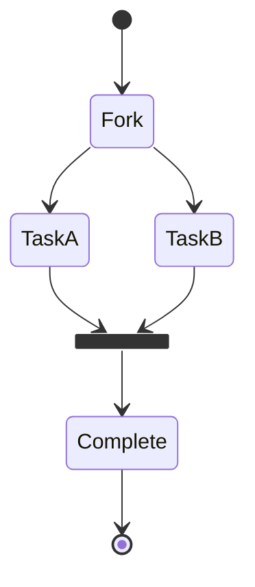
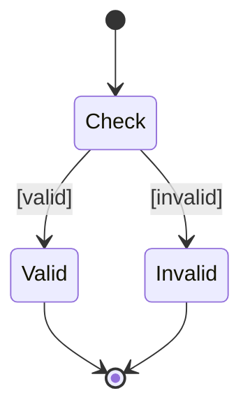
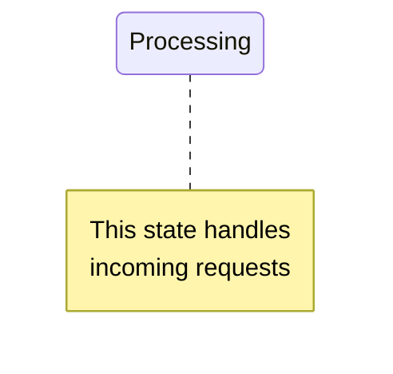

# State Diagram Reference

## Basic Syntax

| Syntax | Meaning |
|--------|---------|
| `[*]` | Start or end state |
| `StateName` | Simple state |
| `StateName: Description` | State with description |

## Transitions

## Composite States

## Forks and Joins

## Choice

## Notes

